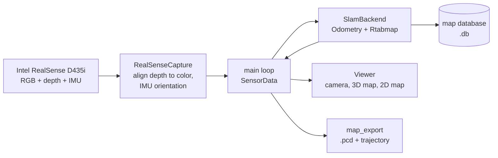
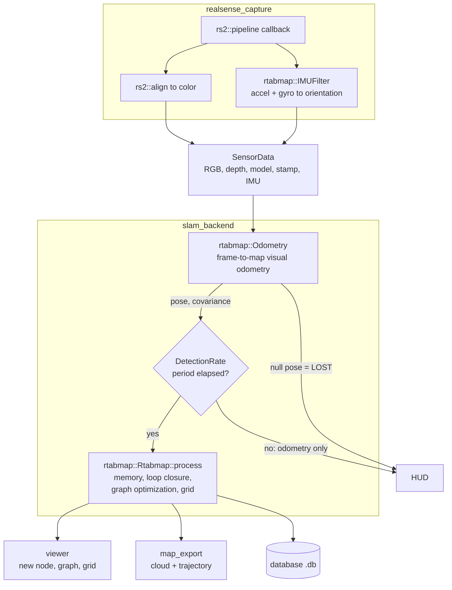
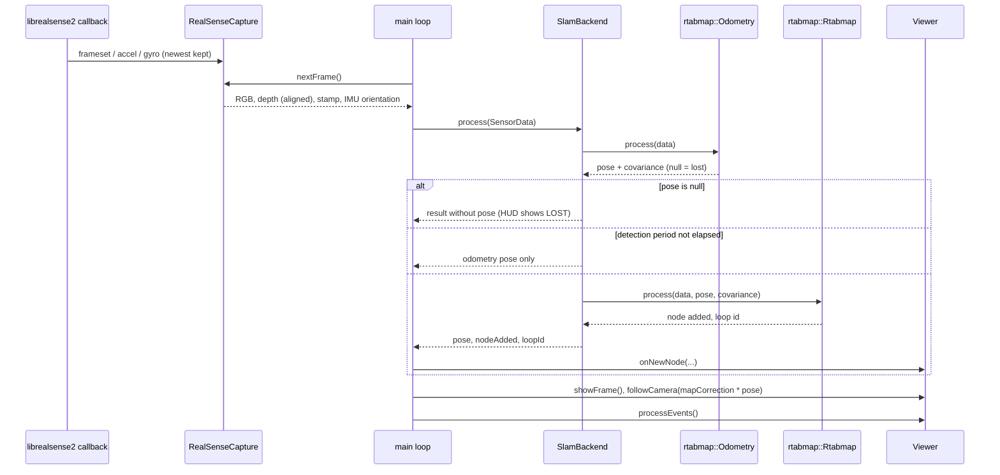

# Architecture

RTAB-SLAM is a C++17 system using the [RTAB-Map](https://github.com/introlab/rtabmap)
library.

Contents: [Overview](#overview) · [Modules](#modules) · [Data flow](#data-flow) ·
[One frame](#one-frame) · [Threads](#threads) · [Shutdown](#shutdown) ·
[Design decisions](#design-decisions) · [Extending](#extending) · [Files](#files)

## Overview



## Modules

Each module has a header in `include/rtab_slam/` and one implementation in `src/`. Every module
takes its own small configuration struct and knows nothing about the others — only `main.cpp` sees
all four.

| Module | Config | Responsibility |
|---|---|---|
| `realsense_capture` | `CaptureConfig` | Starts the librealsense2 pipeline (color and depth at the same resolution, optional accel and gyro), aligns depth to color, builds the `rtabmap::CameraModel` from the camera's intrinsics, turns accel and gyro samples into an orientation with `rtabmap::IMUFilter`, and hands out the newest frame together with the IMU state. |
| `slam_backend` | `SlamConfig` | Loads the RTAB-Map parameters, owns the `rtabmap::Odometry` and `rtabmap::Rtabmap` instances and the database, and applies `Rtabmap/DetectionRate`. Returns a `FrameResult` per frame: odometry pose, whether a node was added, and the loop closure id. |
| `viewer` | `ViewerConfig` | Three windows built from RTAB-Map's own Qt widgets: camera image with a HUD, 3D cloud, and 2D occupancy grid with the pose graph. Also handles the `q` / `s` keys and window close. |
| `map_export` | `ExportPaths` | Assembles the optimized graph into a PCL cloud, voxel-filters it at 3 cm, and writes the `.pcd` and the trajectory file. |
| `main.cpp` | `Options` | Parses the command line, installs the signal handler, runs the loop and owns the shutdown path. |

## Data flow



Outputs:

* `<run>.db` — the full RTAB-Map database (graph, poses, images, visual words, statistics).
* `<run>.pcd` — the assembled cloud, voxel filtered at 3 cm.
* `<run>_trajectory.txt` — `timestamp x y z qx qy qz qw id`.

## One frame



## Threads

* **librealsense2 callback thread.** `RealSenseCapture::onFrame` stores only the newest frameset and
  feeds each accel and gyro sample to the IMU filter, all under one mutex. If the main loop is slow,
  older framesets are dropped rather than queued, so latency stays bounded.
* **Main thread.** Everything else — odometry, mapping, drawing and Qt event processing — runs in the
  single main loop. The windows are RTAB-Map's Qt widgets driven with `processEvents()` from that loop.

The only state shared between the two threads is the capture module's mutex-protected frame and IMU
data; the signal handler touches only a lock-free `std::atomic<bool>`.

## Shutdown

`q`, `Ctrl+C` / `SIGTERM`, closing the windows, a camera failure and an exception inside the loop all
leave the loop and take the same path: stop the camera, export the map (`.pcd` and trajectory), then
close RTAB-Map, which writes the database. The map is therefore saved in every case. The `s` key
runs the export without leaving the loop.

## Design decisions

**`Rtabmap/DetectionRate` is applied by the application.** `Rtabmap::process()` runs the entire
mapping step on every call — dictionary update, loop closure search, graph optimization. The
standalone rtabmap program drops frames in its own thread to honor the configured rate; a direct
library call does not. Without the rate applied in `slam_backend.cpp`, mapping consumed roughly 60%
of wall time and odometry was left with a third of the camera's frames.

**Odometry and map frames are kept apart.** The map windows draw the optimized graph while odometry
keeps running in its own frame, and every loop closure moves one relative to the other. Poses shown
next to the map are transformed by `Rtabmap::getMapCorrection()` first; on a 17 m walk the two
frames differed by 1.13 m by the end.

**Loop closures are checked against link covariance.** RTAB-Map rejects a closure when its
optimization error exceeds `RGBD/OptimizeMaxError` times the standard deviation of a graph link.
F2M odometry reports a very tight covariance, about 6 mm per link, so after a meter of accumulated
drift the stock threshold of 3.0 rejects even well-registered closures — 99 of 101 on one route.
`config/rtab_slam.ini` sets it to 10.

**Gravity tolerance is specified in radians.** The stock `Optimizer/GravitySigma` of 0.3 permits a
17 degree tilt, which let a 19 m walk lean by 5 degrees. At 0.05 the map stays within about
1 degree of the IMU's estimate of vertical. Without an IMU (`--no-imu`) the sigma is forced to 0.

**The IMU noise is tighter than the optimizer's tolerance.** Every IMU sample is passed to RTAB-Map
with a small fixed variance, so that the graph optimizer, not the orientation filter, decides how
much gravity is trusted.

**RTAB-Map's own Qt widgets instead of `PCLVisualizer`.** The three windows reuse the widgets that
`rtabmap-databaseViewer` is built from. `PCLVisualizer` is avoided because of a VTK 9.1 X11
segmentation fault.

**Depth units are normalized.** 16-bit depth stays as millimeters when the camera's depth scale is
0.001 and is converted to 32-bit float meters otherwise, which are the two conventions RTAB-Map
reads.

**The build is gentle on a small machine.** `scripts/build.sh` runs a single-job build under `nice`,
and the binary has an `$ORIGIN`-relative RPATH so the tree can be moved without breaking it.

## Extending

* **A different camera.** Implement the same surface as `RealSenseCapture` — newest RGB, aligned
  depth, a timestamp, an `rtabmap::IMU` and an `rtabmap::CameraModel` — and the rest of the pipeline
  is unchanged.
* **Different odometry or optimizer.** Both are RTAB-Map parameters (`Odom/Strategy`,
  `Optimizer/Strategy`) in `config/rtab_slam.ini`; no code change is needed.
* **More output formats.** `map_export` is the only place that turns the optimized graph into files.

## Files

```
include/rtab_slam/        headers, included as "rtab_slam/<name>.hpp"
├── realsense_capture.hpp camera: newest RGB-D frame and IMU orientation
├── slam_backend.hpp      RTAB-Map: parameters, database, odometry, mapping
├── viewer.hpp            three windows and the HUD
└── map_export.hpp        saving the map: PCL cloud, voxel filter, statistics
src/
├── main.cpp              command line, main loop, shutdown
└── <name>.cpp            one implementation per header above
config/rtab_slam.ini      RTAB-Map parameters, every key documented in place
scripts/                  shell entry points: setup_deps.sh, build.sh, run.sh
tools/                    Python utilities: capture_dataset, calibrate_camera, validate_run
docs/validation.md        field test procedures and acceptance criteria
runs/                     recorded runs (.db, .pcd, trajectory), never committed
```

See also: [README](README.md) · [Validation](docs/validation.md).
