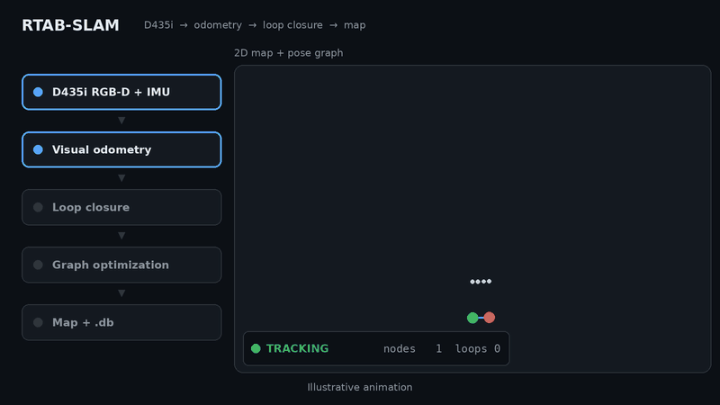

<div align="center">

# RTAB-SLAM

**Real-time RGB-D RTAB-Map SLAM for the Intel RealSense D435i.**

[](LICENSE)




<sub>Illustrative animation.</sub>

</div>

## Contents

- [What you get](#what-you-get)
- [Quick start](#quick-start)
- [Requirements](#requirements)
- [Build](#build)
- [Run](#run)
- [Output](#output)
- [Configuration](#configuration)
- [Validating a run](#validating-a-run)
- [Tools](#tools)
- [Performance](#performance)
- [Key design findings](#key-design-findings)
- [Limitations](#limitations)
- [Documentation](#documentation)
- [License](#license)

## What you get

The camera is driven through librealsense2, depth is aligned to color, IMU samples are fused into
an orientation estimate, and every frame is handed to RTAB-Map as a `SensorData`. RTAB-Map supplies
visual odometry, memory management, loop closure detection and pose-graph optimization.

- **Three live windows** — camera with a status HUD, 3D point cloud, and a 2D occupancy grid with
  the pose graph drawn over it.
- **Three artifacts per run** — an RTAB-Map `.db` database, a 3 cm voxel-filtered `.pcd` point cloud
  and a trajectory file.
- **IMU gravity constraints** — the D435i's IMU keeps the map level.
- **Offline validation** — `tools/validate_run.py` runs eleven checks on a finished database.
- **Standalone** — RTAB-Map is used as a C++ library. ROS 2 is used for the prebuilt RTAB-Map packages.
- **Dependencies without root** — `scripts/setup_deps.sh` unpacks the packages into `./deps`.

```
D435i (RGB + depth aligned to RGB + IMU)
  -> rtabmap::Odometry   visual odometry (F2M)
  -> rtabmap::Rtabmap    memory, loop closure, graph optimization
  -> live windows        camera + HUD, 3D cloud, 2D occupancy grid with the pose graph
  -> artifacts           .db database, .pcd point cloud, trajectory file
```

See [ARCHITECTURE.md](ARCHITECTURE.md) for the details.

> [!NOTE]
> A live run needs a physical Intel RealSense D435i. Without one you can still inspect a recorded
> map: `tools/validate_run.py` and `rtabmap-databaseViewer` work on a `.db` file alone.

## Quick start

```bash
sudo apt update && sudo apt install ros-jazzy-rtabmap ros-jazzy-librealsense2
./scripts/build.sh
./scripts/run.sh
```

Plug in the D435i first. `q` saves and exits, `s` saves without leaving.
Artifacts land in `runs/<timestamp>.{db,pcd}` and `runs/<timestamp>_trajectory.txt`.

Without root, see [Dependencies without root](#dependencies-without-root).

## Requirements

| Component | Version | Source |
|---|---|---|
| RTAB-Map | 0.23.7 | `ros-jazzy-rtabmap` (used as a C++ library) |
| g2o / GTSAM | bundled with the package | graph optimizers |
| librealsense2 | 2.58.4 | `ros-jazzy-librealsense2`, or a local Intel SDK build |
| OpenCV | 4.6.0 | system |
| PCL | 1.14.0 | system |
| Eigen | 3.4 | system |

Built and tested on Ubuntu 24.04 with ROS 2 Jazzy.

`apt update` matters: a stale index still lists a package version that is no longer on the server.
`librealsense2-dev` is not in the stock Ubuntu repositories; `ros-jazzy-librealsense2` from the ROS 2
repository carries the same SDK, and a local build still works too.

One version constraint is stricter than it looks: `tools/calibrate_camera.py` uses the pre-4.7
OpenCV ArUco API (`CharucoBoard_create`, `Dictionary_get`, `DetectorParameters_create`), which the
4.7 rewrite replaced. That tool therefore needs OpenCV 4.6 — the system one. The SLAM binary itself
is unaffected.

### Dependencies without root

The same `.deb` packages are downloaded and unpacked into `./deps`:

```bash
./scripts/setup_deps.sh
```

When `./deps` exists it takes precedence over a system-wide installation. To build against the
system packages again, delete the directory or pass `-DDEPS_DIR=/nonexistent` to CMake. Point the
script at your own librealsense build with `RS_SRC=/path/to/librealsense ./scripts/setup_deps.sh`.

## Build

```bash
./scripts/build.sh
```

A single-job build under `nice`, which keeps a dual-core machine responsive. The binary lands in
`build/rtab_slam` with an `$ORIGIN`-relative RPATH, so the tree can be moved without breaking it.

## Run

```bash
./scripts/run.sh                    # artifacts go to runs/<timestamp>.*
./scripts/run.sh --no-map3d         # without the 3D cloud window
./scripts/run.sh --no-gui           # headless, status to the console
./scripts/run.sh --no-imu           # no IMU, and therefore no gravity constraints
./scripts/run.sh --continue         # append a session to the existing database
./scripts/run.sh --fps 30           # shorter exposure, sharper frames under motion
./scripts/run.sh --db runs/loop_1.db --cloud runs/loop_1.pcd --traj runs/loop_1_trajectory.txt
```

Every option, as `rtab_slam --help` prints them:

| Option | Meaning |
|---|---|
| `--config f.ini` | parameter file; default `config/rtab_slam.ini`, RTAB-Map defaults when it is missing |
| `--db out.db` | map database to write |
| `--cloud out.pcd` | assembled point cloud to write |
| `--traj out.txt` | trajectory file to write |
| `--continue` | append a session instead of replacing an existing database |
| `--no-imu` | do not stream the IMU; also disables gravity constraints |
| `--no-gui` | no windows at all, status to the console |
| `--no-view` | no camera window (the two map windows stay) |
| `--no-map3d` | no 3D cloud window |
| `--no-map2d` | no 2D map window; also stops building the occupancy grid |
| `--fps N` | camera frame rate, 5 to 90; default 15 |
| `--size W H` | camera resolution, 160x120 to 1920x1080; default 640 480 |

Without `--db`, `--cloud` and `--traj` `scripts/run.sh` writes `runs/<timestamp>.{db,pcd}` and
`runs/<timestamp>_trajectory.txt`, so the repository root stays free of run output. The binary
itself writes to the current directory when it is started directly.

`q` saves and exits, `s` saves without leaving. Closing the windows, `Ctrl+C` and a camera failure
all take the same shutdown path, so the map is written in every case.

### Windows

* **camera** — the live image with tracked features and a HUD: `TRACKING` / `LOST`, feature and
  inlier counts, processed frames, rate, map nodes, loop closures, current position.
* **3D map** — one cloud per map node, added as the node is created. A loop closure re-poses the
  clouds that are already on screen instead of rebuilding them.
* **2D map** — occupancy grid from above: free space white, obstacles black, unknown gray, with the
  pose graph drawn over it — odometry links in blue, loop closures in red, the current camera pose
  as an axis marker.

All three are RTAB-Map's own Qt widgets, the same ones `rtabmap-databaseViewer` is built from.
Nodes that RTAB-Map moves into long-term memory drop out of the 3D window, which is what bounds
memory use during a long session; the database and the exported cloud keep every node.

## Output

`q`, `s` and `Ctrl+C` all write:

* `<run>.db` — the full RTAB-Map database: graph, poses, images, visual words, per-iteration
  statistics. An existing database is replaced unless `--continue` is given.
* `<run>.pcd` — the assembled cloud, voxel filtered at 3 cm.
* `<run>_trajectory.txt` — `timestamp x y z qx qy qz qw id`.

`<run>` is `runs/<timestamp>` by default; `--db`, `--cloud` and `--traj` override each path.

Inspect a run with the standard tools:

```bash
rtabmap-databaseViewer runs/loop_1.db
rtabmap-info runs/loop_1.db
```

## Configuration

Every key in `config/rtab_slam.ini` is a stock RTAB-Map parameter (`rtabmap --params`) and carries
the reasoning for its value. The ones that matter most:

| Parameter | Effect |
|---|---|
| `Rtabmap\DetectionRate` | how often a map node is created — the main CPU control |
| `RGBD\OptimizeMaxError` | the ratio above which a loop closure is rejected as inconsistent |
| `Optimizer\GravitySigma` | how tightly IMU gravity holds the map level, in radians |
| `Vis\MaxFeatures`, `OdomF2M\MaxSize` | odometry accuracy against frame time |
| `Vis\CorGuessWinSize` | how far a feature may travel between frames before tracking gives up |
| `Grid\RayTracing`, `Grid\3D` | whether the 2D map shows free space or only obstacles |
| `Grid\RangeMax` | depth range trusted for the occupancy grid |

## Validating a run

`tools/validate_run.py` reads a finished database read-only and reports eleven checks covering
export integrity, map segmentation after a tracking loss, IMU consistency and latency, loop closure
acceptance and plausibility, graph correction, odometry covariance, timing and calibration
stability.

```bash
./tools/validate_run.py runs/loop_1.db
./tools/validate_run.py --traj runs/loop_1_trajectory.txt runs/loop_1.db
./tools/validate_run.py runs/*.db      # one row per run, plus the spread across runs
```

Example output (abridged):

```
nodes 61 | 81 s | travelled 11.5 m | optimized poses from database
links: 60 odometry, 30 loop closure, 9 proximity, 61 gravity
  PASS gravity links          61 for 61 nodes
  PASS IMU agreement          roll mean +0.03 p95 1.94, pitch mean +0.05 p95 1.64 deg
  PASS loop closures          30 accepted, 39 proximity, 2 rejected; inliers min 27
  PASS timing                 p50 121 p95 190 max 413 ms, 0/85 above Rtabmap/TimeThr=700
```

The first line summarizes the run (nodes, duration, distance); the second counts the graph links by
type. Each following line is one check: its name, then the measured values. `IMU agreement` compares
the IMU's roll and pitch with the optimized poses (mean and 95th percentile, in degrees);
`loop closures` counts accepted and rejected closures and the smallest inlier count among them;
`timing` shows per-frame mapping time against the `Rtabmap/TimeThr` budget.

Thresholds are constants at the top of the script and are read from the run's own parameters where
RTAB-Map stores them. The exit code is 1 when a check fails. [docs/validation.md](docs/validation.md)
describes the field procedures these checks are designed around.

## Tools

`tools/capture_dataset.py` captures a raw dataset from the D435i — synchronized IR, color and
depth frames with metadata, saved atomically under operator control.

`tools/calibrate_camera.py` computes RGB intrinsics from a ChArUco board over such a dataset,
with outlier rejection, an intra-dataset hold-out validation and an optional visual diagnostics
report.

Both are run from the project root, and their default paths line up: the capture writes to
`./dataset`, the calibration reads it from there and writes its result to `./calibration_output`.

```bash
./tools/capture_dataset.py                    # -> ./dataset
./tools/calibrate_camera.py --visualize       # ./dataset -> ./calibration_output
```

Both need `pyrealsense2` and OpenCV. Ubuntu 24.04 marks its system Python externally managed
(PEP 668), so install into a virtual environment that keeps the system OpenCV visible — the
calibration tool needs the system 4.6, and a pip `opencv-python` would break it:

```bash
python3 -m venv --system-site-packages ~/venvs/robotics
~/venvs/robotics/bin/pip install pyrealsense2
~/venvs/robotics/bin/python tools/capture_dataset.py --help
```

Captured datasets are excluded from version control.

## Performance

Measured on an Intel Core i3-3110M (two cores, 2.4 GHz) at 640x480. These numbers describe that one
laptop; a faster machine will do better.

In normal operation, with mapping running at `Rtabmap\DetectionRate`, the pipeline keeps up with
the camera: 15 Hz headless and around 6 Hz with all three windows open.

A deliberate worst case, with a map node created on every frame
(`RGBD\LinearUpdate = 0`, `RGBD\AngularUpdate = 0`):

| Mode | Rate |
|---|---|
| `--no-gui` | 5.2 Hz |
| camera + 2D map | 3.5 Hz |
| all three windows | 3.3 Hz |

The map windows repaint at most five times per second and only change when a node is created, so
between nodes they cost almost nothing.

## Key design findings

Four things were learned the hard way and are worth knowing before changing parameters. The full
reasoning is in [ARCHITECTURE.md](ARCHITECTURE.md#design-decisions).

- **`Rtabmap/DetectionRate` is applied by the application.** A direct library call to
  `Rtabmap::process()` runs the whole mapping step every time; without the rate applied in
  `slam_backend.cpp`, mapping consumed roughly 60% of wall time and odometry was left with a third
  of the camera's frames.
- **Odometry and map frames are kept apart.** Every loop closure moves one relative to the other;
  poses shown next to the map go through `Rtabmap::getMapCorrection()`. On a 17 m walk the frames
  differed by 1.13 m.
- **`RGBD/OptimizeMaxError` is raised to 10.** F2M odometry reports a very tight covariance (about
  6 mm per link), so the stock 3.0 rejected 99 of 101 well-registered closures on one route.
- **`Optimizer/GravitySigma` is 0.05 rad.** The stock 0.3 permits a 17 degree tilt and let a 19 m
  walk lean by 5 degrees; at 0.05 the map stays within about 1 degree of the IMU's vertical.

## Limitations

* Visual odometry needs texture. Plain walls, smooth doors and unlit rooms cause tracking losses
  that no parameter can prevent.
* Depth noise grows with the square of distance — roughly 2 cm at 1.5 m and 5.5 cm at 2.8 m — which
  sets how thin a wall can appear on the occupancy grid.
* IMU orientation is sampled when a frame is consumed rather than interpolated to the frame's
  timestamp. The difference is negligible when still and grows with rotation speed.
* Color distortion coefficients reported by the camera are not passed to the camera model.
* `Rtabmap::getGraph()` materializes the whole map in memory when exporting; for long sessions use
  `rtabmap-export` on the database instead.

## Documentation

| Document | Contents |
|---|---|
| [ARCHITECTURE.md](ARCHITECTURE.md) | modules, data flow, threads, shutdown path, design decisions |
| [docs/validation.md](docs/validation.md) | field test procedures T0–T8 and acceptance criteria |
| [config/rtab_slam.ini](config/rtab_slam.ini) | every RTAB-Map parameter, documented in place |

## License

Licensed under the [Apache License, Version 2.0](LICENSE).

## Acknowledgements

Built using [RTAB-Map](https://github.com/introlab/rtabmap) by IntRoLab and
[librealsense](https://github.com/IntelRealSense/librealsense) by Intel.
